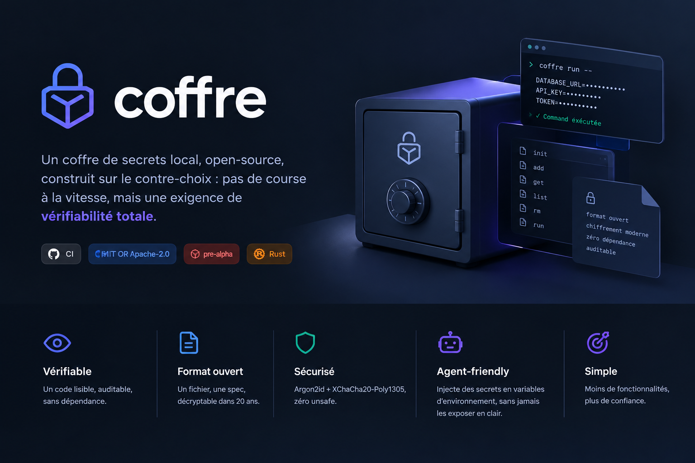

<p align="center"><a href="README.md">Français</a> | <strong>English</strong></p>

<h1 align="center">coffre</h1>

<p align="center">
  <strong>A local-first, open-source secret vault built on the counter-trade-off:<br>
  no race for speed, but a demand for <em>total verifiability</em>.</strong>
</p>

<p align="center">
  <a href="https://github.com/QuantumCraftr/coffre/actions/workflows/ci.yml"></a>
  <a href="#license"></a>
  <a href="#status"></a>
  <a href="https://www.rust-lang.org"></a>
</p>

<p align="center">
  
</p>

> In an era where most code is generated by AI, `coffre` makes the opposite bet: a daily-use tool whose every line you can actually read and audit, rather than a large binary you trust on reputation.

## Status

**Pre-alpha.** Phases 0, 1 and 2 are complete: validated primitives (Argon2id, XChaCha20-Poly1305), format v1, `Vault` layer (atomic writes, zeroization), CLI (`init`, `add`, `get`, `list`, `rm`, `run`), property-based tests, libFuzzer fuzzing, ASan and Miri. No external audit yet: **do not store critical secrets with it yet.** See [SECURITY.md](SECURITY.md) and [PLAN.md](PLAN.md).

## Why this is not a "Bitwarden killer"

Bitwarden and KeePass are battle-tested and very good. `coffre` does not try to do more: it tries to do **less**, so a single person can audit the whole codebase. Three axes:

1. **Verifiability**: a tiny scope you can read in full, with a minimal, fully justified dependency set.
2. **Open format**: a file whose spec fits on one page, decryptable 20 years from now.
3. **AI-agent bridge**: inject secrets as environment variables without ever exposing their value in a conversation.

## Principles

- **Minimal dependencies**: none added by default; every dependency requires a written justification.
- **Zero `unsafe`** (or confined and justified line by line).
- **Small scope**: less surface, fewer possible flaws.
- **Verification over speed**: cross-validation, property-based testing, fuzzing, mandatory human review.

## Target features (v1)

- `init`: create an encrypted vault.
- `add` / `get` / `list` / `rm`: manage secrets.
- `run`: run a command with secrets injected as environment variables, without printing them (broker mode for AI agents).

## Technical choices

| Topic | Decision |
| --- | --- |
| Language | Rust (edition 2024) |
| Key derivation | Argon2id (m=64 MiB, t=3, p=1) |
| Encryption | XChaCha20-Poly1305 (256-bit key, 192-bit nonce) |
| Integrity | AEAD Poly1305 tag, bound to the header |
| Dependencies | Minimal and justified (5 direct), pinned RustCrypto primitives |
| Verification | Cross-validation (libsodium, reference C Argon2) |

The full threat model is documented and versioned: [THREAT_MODEL.en.md](THREAT_MODEL.en.md).
The file format specification: [FORMAT.en.md](FORMAT.en.md).
Every dependency is justified: [DEPENDENCIES.md](DEPENDENCIES.md).

## Getting started

```bash
curl --proto '=https' --tlsv1.2 -sSf https://sh.rustup.rs | sh   # Rust (if missing)
rustup component add rustfmt clippy                               # components
cargo install cargo-audit cargo-deny                             # control tools
cargo build
```

## Usage

```bash
coffre init ~/.coffre/vault                 # create the vault (passphrase requested)
coffre add  ~/.coffre/vault github_token     # value read from stdin or prompted
coffre get  ~/.coffre/vault github_token     # print the value
coffre list ~/.coffre/vault                  # list names
coffre rm   ~/.coffre/vault github_token     # remove
coffre run  ~/.coffre/vault GITHUB_TOKEN -- ./deploy.sh   # inject GITHUB_TOKEN as env var
```

The passphrase is prompted on the terminal (without echo). For automation,
`COFFRE_PASSPHRASE` can provide it, with the same caution as any password passed
through an environment variable (visible to the same user and root).

`run` injects the requested secrets into the child process environment, without ever
printing them from `coffre`. Known limit: a process environment is readable by the same
user and root (`/proc/<pid>/environ`). Intended for agents and scripts.

`get` prints the value followed by a newline; keep that in mind for binary secrets.

## Useful commands

```bash
cargo fmt --all --check                                  # format
cargo clippy --workspace --all-targets -- -D warnings    # strict lint
cargo test --workspace                                   # tests
cargo audit                                              # vulnerabilities (RustSec)
cargo deny check                                         # supply chain (bans, licenses, sources)
cargo +nightly miri test -p coffre-core                  # undefined behavior (Miri)
RUSTFLAGS="-Zsanitizer=address" cargo test -p coffre-core --tests   # AddressSanitizer
cargo +nightly fuzz run payload_decode -- -runs=100000    # fuzzing (libFuzzer)
.venv/bin/python scripts/gen_vectors.py                  # regenerate reference vectors
```

CI runs these commands on every push.

## Layout

```
coffre/
  Cargo.toml                 # workspace
  deny.toml                  # cargo-deny (advisories, bans, licenses, sources)
  .github/workflows/ci.yml   # CI: fmt, clippy, test, audit, deny, miri, asan, fuzz
  coffre-core/               # library: format, crypto, zeroization
  coffre-cli/                # binary: init, add, get, list, rm, run
```

## License

Dual-licensed under either [MIT](LICENSE-MIT) or [Apache-2.0](LICENSE-APACHE), at your option.
